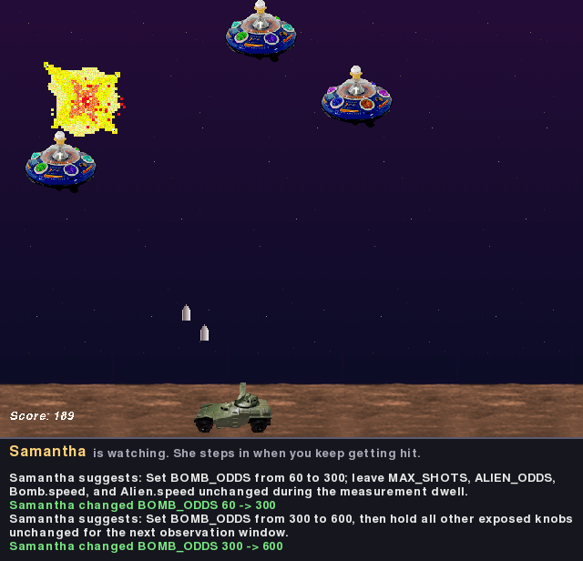
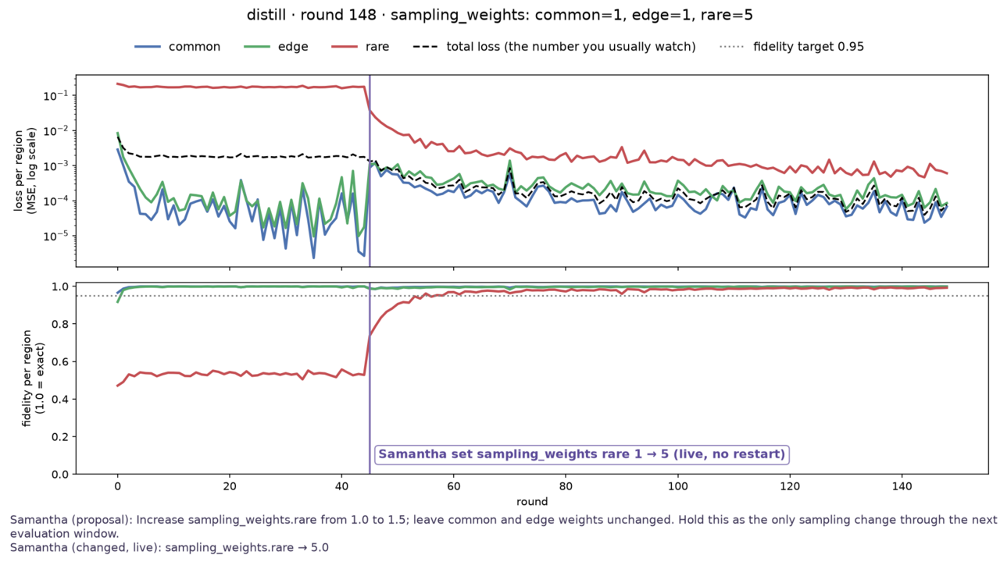

# Samantha

Samantha lives inside your Python program. Add `import samantha`: she reads the
code, watches what it prints, notices when a goal is not met, and, if you let
her, changes the running program to meet it. No restart, no wrapper command.



## Install

You need Python 3.12, 3.13, or 3.14 on macOS or Linux, and an OpenAI API key.

```console
git clone https://github.com/gharman/samantha.git
cd samantha
python3 -m venv .venv
source .venv/bin/activate
python -m pip install -e ".[demos]"
cp .env.example .env
```

Open `.env` and put your key after `OPENAI_API_KEY=`. An environment variable
also works (`export OPENAI_API_KEY=sk-...`), and it wins over `.env`.

## Demo 1: Samantha helps you win a game

```console
python demo.py aliens
```

pygame's alien shooter. Samantha reads the game and plans her first move (about
20 s). Then press P to play: arrows move, Space fires, Esc quits. Her messages
show under the game and in the terminal. While you do not get hit, she does
nothing. When you get hit the first time, she makes the game easier at once:
look for the green line "Samantha changed ...", less than 1 s after the hit.
If the hits continue, she can change the game again, at most once every 10 s.

## Demo 2: Samantha fixes a training run

```console
python demo.py training
```

A small training run with a live plot. One region of the data never trains,
but the total loss looks fine. At about round 30 Samantha notices it. Then she
raises that region's sampling weight in the running process, the plot marks
her change, and the red curve goes up. Close the plot window to stop.



## Talk to Samantha (optional)

You do not need a second window. To talk to her, run
`source .venv/bin/activate` and then `samantha` in a second terminal in this
folder, and type, for example, `help` or `slow the aliens down`. To make her
wait for you instead of acting by herself: `python demo.py aliens --wait`.

## Use Samantha in your own program

In your program's venv, run `python -m pip install -e /path/to/samantha`. Then:

```python
import samantha  # Samantha starts here

# daemon: goal: every region reaches fidelity 0.95
# daemon: sampling_weights are fair game within 0.1-5.0

samantha.expose("rare_weight", obj=weights, attr="rare", bounds=(0.1, 5.0))
print(f"fidelity: {fidelity:.3f} (target 0.95)")  # a metric with a target
```

Put `OPENAI_API_KEY` in a `.env` in your project folder, or in the environment.
By default Samantha only gives advice. `SAMANTHA=act` lets her change the
program, and `SAMANTHA_AUTONOMY=goal` lets her do it without being asked. The
[guide](docs/GUIDE.md) has the details: settings, chat, limits, and the demos.

## If the install fails

- pip tries to build `pygame` (`SDL.h` not found): the venv is not active, or it
  is an old one (`python -m pip --version` must show `.venv`). Run `deactivate`
  and `rm -rf .venv`, then do the install again. The demos use `pygame-ce`,
  which has wheels for Python 3.12-3.14.
- Debian or Ubuntu: if `python3 -m venv` fails, `sudo apt install python3-venv`.
